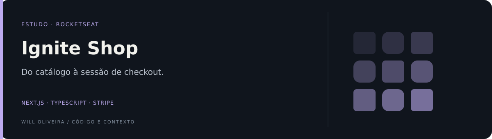

<p align="center">
  
</p>

# Ignite Shop · catálogo e checkout

Loja de demonstração com produtos, detalhes e redirecionamento para checkout do Stripe.

Projeto de estudo da trilha Ignite da Rocketseat: Next.js 13, React, TypeScript, Stitches e Keen Slider.

## Explore o diferencial

| Ponto de entrada | O que observar |
| --- | --- |
| [Fronteira cliente e servidor](src/pages/api/checkout.ts) | A sessão de checkout é criada em uma rota de API do Next.js. |
| [Experiência de produto](src/pages/product/[id].tsx) | A página de detalhes liga a apresentação do item ao fluxo de compra. |

## Destaques

- Catálogo e detalhes consultados no Stripe.
- Criação de sessão de checkout no servidor.
- Página de retorno após checkout.

<details>
<summary><strong>Organização e código</strong></summary>

### Por dentro do código

| Código | O que observar |
| --- | --- |
| [`src/pages/index.tsx`](src/pages/index.tsx) | Catálogo. |
| [`src/pages/product/[id].tsx`](src/pages/product/[id].tsx) | Detalhes. |
| [`src/pages/api/checkout.ts`](src/pages/api/checkout.ts) | Sessão de checkout. |
| [`src/lib/stripe.ts`](src/lib/stripe.ts) | Cliente Stripe. |
| [`src/pages/success.tsx`](src/pages/success.tsx) | Retorno. |

</details>

<details>
<summary><strong>Executar e consultar</strong></summary>

### Executar localmente

Requer Node.js e npm compatíveis com as dependências versionadas.

```bash
git clone https://github.com/Will-Ifes/04-ignite-shop.git
cd 04-ignite-shop
npm install
npm run dev
```

Abra o endereço informado pelo servidor no terminal.

Antes de iniciar, configure `.env.local` com `STRIPE_SECRET_KEY` da sua conta em modo de teste e `NEXT_URL=http://localhost:3000`. Cadastre produtos e preços de teste. A chave secreta permanece no servidor.

### Comandos disponíveis

| Comando | Script versionado |
| --- | --- |
| `npm run dev` | `next dev` |
| `npm run build` | `next build` |
| `npm start` | `next start` |
| `npm run lint` | `next lint` |

</details>

<details>
<summary>Escopo e referências</summary>

Sem fluxo completo de pedidos, estoque ou webhook de confirmação. A página de retorno não substitui confirmação financeira no servidor.

</details>

---

Mantido por **Will Oliveira** · [Perfil](https://github.com/Will-Ifes) · [LinkedIn](https://www.linkedin.com/in/wildemberg-de-jesus-oliveira/)
